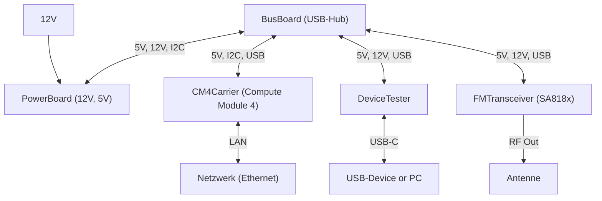

# Hardware

Die Hardware der Remote-Station besteht aus Modulen, die an einer gemeinsamen Bus-Platine stecken. Warum wir sie selbst bauen, zeigt der Blick auf die Alternativen. Stand: November 2026.

## Warum Selbstbau?

**Teure Funkgeräte.** Es gibt Funkgeräte mit eingebautem Remote-Betrieb, sie kosten aber mehrere hundert Euro. Wer will so ein Gerät schon im Baum weit draußen aufhängen? Dazu kommt: Der Aufbau dieser Geräte ist meist nicht outdoor-tauglich.

**Billige Handfunkgeräte aus China.** Sie können viel, lassen sich leicht umprogrammieren und sind als fertige Hardware verfügbar. Meist können sie aber nicht gleichzeitig Daten und Audio mit einem PC austauschen. Sie sind schwer zu steuern und ebenfalls nicht outdoor-tauglich.

**Selbstbau.** Deshalb bauen wir selbst, auf Basis von FM-Modulen wie dem SA818U und SA818V. Der Aufbau ist modular, damit sich defekte Module leicht tauschen lassen. Eine Bus-Platine im hinteren Teil des Gehäuses verbindet die Platinen. Ähnliche Systeme wurden früher in 19-Zoll-Technik für komplizierte Projekte gebaut, Beispiele findest du [hier](https://merath.com/19-zoll-technik).

## Modularer Aufbau

Alle Module haben 100 × 100 mm. Das sind die vorhandenen Module:

- **BusBoard** (ca. 117 × 100 mm): Die Bus-Platine mit einem USB-2.0-Hub. Die Module stecken über PCN10-Steckverbinder an. Der Hub übernimmt die Kommunikation zwischen den Modulen.
- **CM4Carrier**: Trägt das Raspberry Pi Compute Module 4 und übernimmt die High-Level-Aufgaben.
- **PowerBoard**: Erzeugt die nötigen Spannungen. Es wird mit 12 V über einen XT60-Stecker versorgt und liefert 5 V über einen Buck-Wandler. Außerdem misst es den Strom.
- **FMTransceiver**: Das Funkmodul mit SA818V oder SA818U und einem STM32U575. Der STM32 stellt am USB eine serielle Steuer-Schnittstelle, eine Soundkarte und einen Firmware-Update-Zugang bereit.
- **DeviceTester**: Ein Testmodul der Plattform mit USB-C-Anschluss zu einem USB-Gerät oder PC.

Alle Low-Level-Module tragen einen STM32, der die Ein- und Ausgänge für ihre Aufgabe bereitstellt. Die Details zu jedem Modul findest du auf den Unterseiten.

