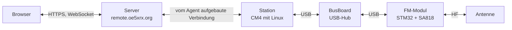

# Technik

Die Remote-Station von OE5XRX ist ein modulares System: Ein kleiner Linux-Rechner, ein USB-Bus und austauschbare Funkmodule, bedient über eine Weboberfläche. Auf dieser Seite siehst du, wie die Teile zusammenspielen. Stand: November 2026.

## Gesamtsystem

## Funken im Browser

1. Du öffnest die Weboberfläche und wählst eine Station. Die Bedienelemente werden aus der Beschreibung erzeugt, die das Funkmodul über sich selbst liefert (Frequenz, Squelch, PTT und so weiter).
2. Ein Steuerbefehl geht vom Browser an den Server. Der Server leitet ihn an die Station weiter.
3. Auf der Station nimmt der Agent, ein Dienst auf dem CM4, den Befehl entgegen. Er baut die Verbindung zum Server immer selbst nach außen auf. Deshalb funktioniert die Station auch hinter NAT (z.B. über einen LTE-Router), ohne dass Ports geöffnet werden müssen.
4. Der Agent gibt den Befehl über USB an die Shell des Moduls. Der STM32 auf dem Modul steuert das SA818, das Funkmodul (derzeit für 2 m).
5. Der Empfangston läuft so: Das Modul meldet sich am USB als Soundkarte, der Agent kodiert das Audio als Opus und schickt es über WebSocket an den Server, der es an die Browser verteilt. Beim Senden läuft der Ton aus deinem Browser den umgekehrten Weg zum Modul.
6. Sender gibt es nur einen pro Station: Der Server vergibt eine exklusive Sendesperre, damit nie zwei Personen gleichzeitig tasten.

Wie du als Mitglied praktisch vorgehst, steht in der Anleitung [So funkst du über die Station]().

## Designprinzipien

- **Modular.** Die Module sind Platinen im Format 100 × 100 mm und hängen an einem gemeinsamen USB-Bus. Ein defektes Modul wird getauscht, nicht die ganze Station.
- **Selbstbeschreibende Module.** Jedes Modul liefert eine Beschreibung seiner Fähigkeiten mit. Die Weboberfläche erzeugt daraus die Bedienung. Für ein neues Modul braucht es keine neue Oberfläche.
- **Sichere Updates auf allen Ebenen.** Das Linux-Image (samt Agent) und die Modul-Firmware werden signiert verteilt. Schlägt ein Update fehl, kehrt das System automatisch zum letzten funktionierenden Stand zurück.
- **Open Source.** Hardware, Firmware und Software sind offen und auf GitHub einsehbar.

## Weiter im Detail

- [Hardware](): Module, Bus und Aufbau
- [Software](): Server, Stations-Image und Modul-Firmware
- [Mitbauen](): Repos, Arbeitsweise und Kontakt
